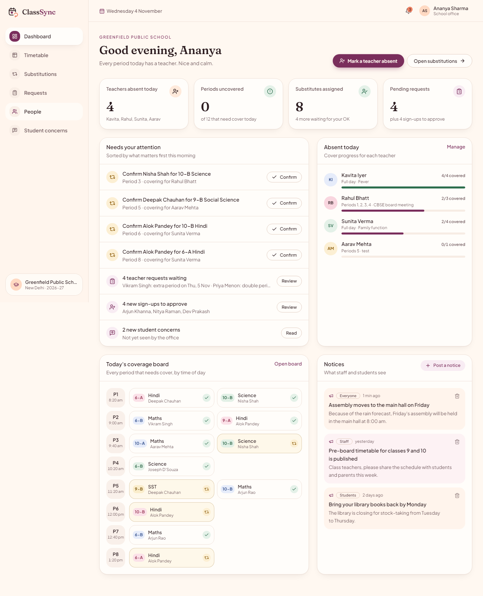
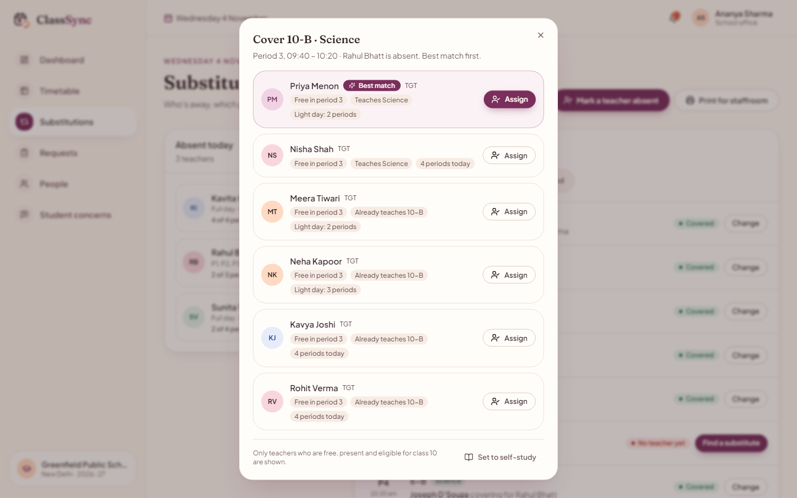
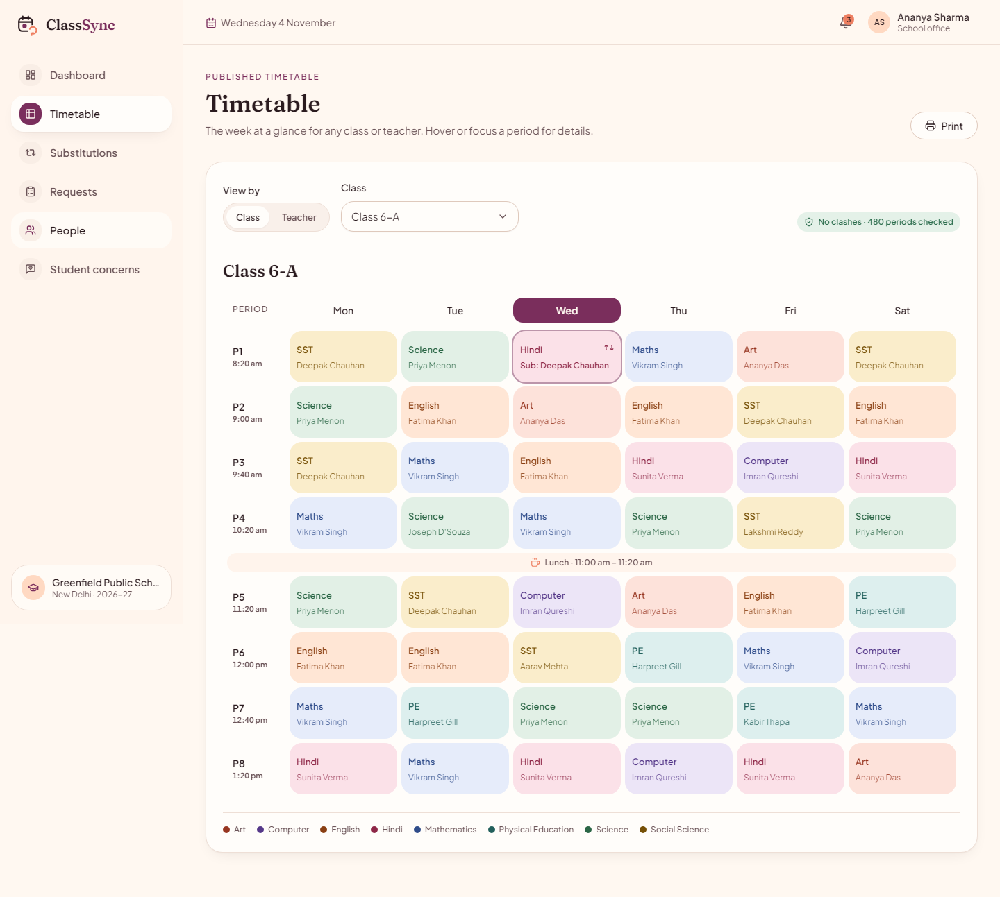
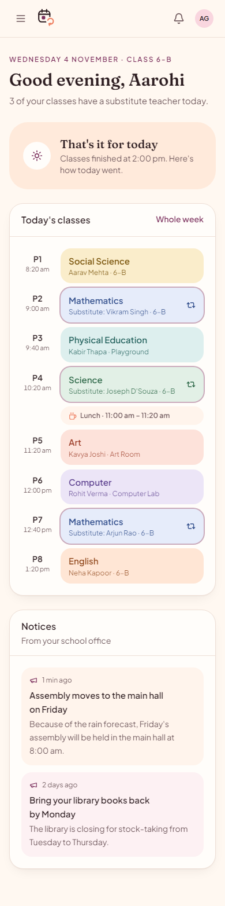
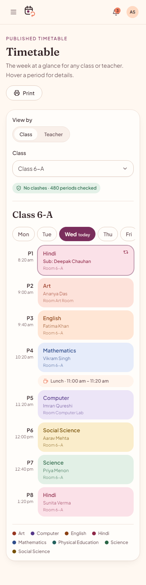

# ClassSync

**Timetables, substitutions and daily coverage for Indian schools.**
ClassSync builds a clash-free weekly timetable, suggests the right substitute when a teacher is absent, and shows principals, teachers and students exactly who is teaching every period.


## Quick start

```bash
npm install
npm run seed   # optional: the API also seeds the demo school on start
npm run dev    # client on http://localhost:5173, API on http://localhost:4000
```

Open the site and press **Try the live demo**, then pick **Principal**, **Teacher** or **Student** on the sign-in page. No setup is needed: if MongoDB isn't running locally, demo mode starts a temporary in-memory database (the first start downloads a MongoDB binary).

Port 4000 already taken? Run `API_PORT=4100 npm run dev` and the dev proxy follows.

### Demo accounts

| Role | Sign in with | Password |
| --- | --- | --- |
| Principal (school office) | `admin@classsync.school` | `admin123` |
| Teacher (Vikram Singh) | `teacher@classsync.school` or phone `9810012345` | `teacher123` |
| Student (Aarohi Gupta) | School *Greenfield Public School*, admission no. `A1042` | `student123` |

The demo school is rebuilt on every API start, so it always opens on a realistic "today": three teachers absent, most cover arranged, two periods still needing a teacher, four requests and four sign-ups waiting.

**Without an API (static hosting such as Lovable):** the demo buttons still work. When no API answers, the app opens a recorded copy of the sample school that runs in the browser (`src/demo/`). Visitors' changes stay in their browser until they sign out. After changing the seed or the read models, refresh the recording with `npm run demo:capture`.

## What's inside

| Screen | What it does |
| --- | --- |
| Landing (`/`) | Product story for school owners and principals: about, features, how it works, roles, FAQ |
| Class timetable (`/schedule`) | Public, read-only class timetable for students and parents |
| Admin dashboard | Today's absences, uncovered periods, things needing attention, coverage board, notices |
| Substitutions | Ranked substitute suggestions with reasons; assign, confirm or set self-study |
| Timetable | Weekly grid by class or teacher with subject colours and a clash check |
| Requests · People · Student concerns | Approvals, accounts and concerns with clear status |
| Teacher | My day (with cover duties), weekly routine, requests |
| Student | Next class, today with substitutes, weekly timetable, raise a concern |

<p>
  
  
</p>
<p>
  
  
  
</p>

## Stack

- **Client:** Vite, React 18, React Router, TanStack Query, Tailwind CSS with design tokens in `src/index.css`, Radix primitives in `src/components/ui`.
- **Server:** Express, TypeScript, Mongoose, Zod. Routes live in `server/routes`; the demo data is in `server/services/seedDemoData.ts`.
- **Design system:** cream/peach/blush palette with a plum accent, Fraunces + Plus Jakarta Sans. All colours are CSS variables (`:root` in `src/index.css`) mapped in `tailwind.config.js`.

## Scripts

```bash
npm run dev        # client + API
npm run build      # typecheck and build the client
npm run typecheck  # client and server
npm run lint       # ESLint for src and server
npm run test       # Vitest
npm run seed       # rebuild the demo school
npm run demo:capture  # re-record the in-browser sample school (src/demo/snapshot.json)
```

## Environment

Copy `.env.example` to `.env` to customise. Key values: `MONGO_URI`, `JWT_SECRET`, `DEMO_MODE` (in-memory fallback, demo OTP codes on screen, relaxed sign-in rate limit) and `EMAIL_PROVIDER` (`console` prints OTP codes in the API log).
